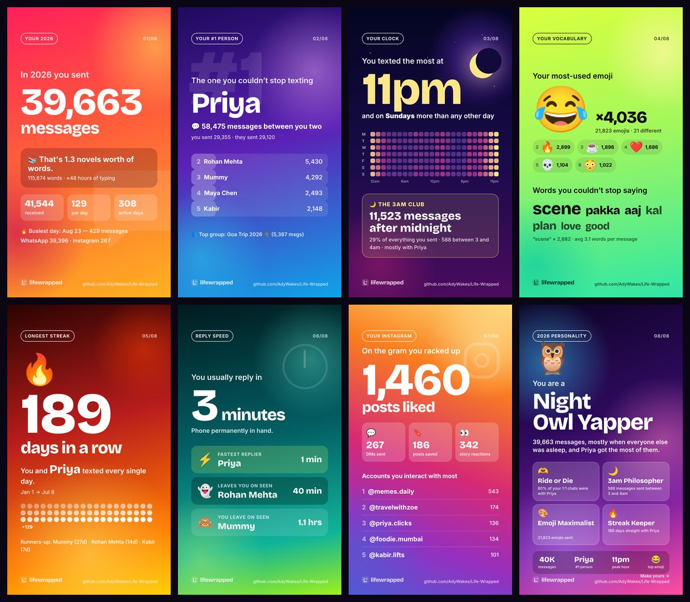

<div align="center">

# lifewrapped

**Your year in chats, wrapped.** A Spotify Wrapped–style story made from your own WhatsApp & Instagram exports. 100% in your browser.

<!-- TODO before launch: replace with a 6–8s screen recording of the demo (docs/demo.gif, ~600px wide) -->


[**Try it →**](https://adywakes.github.io/Life-Wrapped/) · [Privacy](#privacy) · [Export your data](#how-to-export-your-data) · [Contribute](#contributing)

</div>

---

Drop your WhatsApp chat export and/or Instagram data download. lifewrapped parses it **locally**, then plays an animated story — tap and swipe like Instagram Stories — of up to 8 cards:

| # | Card | What it shows |
|---|------|---------------|
| 1 | **Messages** | Total messages you sent this year, “that’s 1.3 novels”, busiest day, vs last year |
| 2 | **#1 person** | Who you texted the most + your top 5 |
| 3 | **Your clock** | 7×24 heatmap of when you text, peak hour, and the **3am club** |
| 4 | **Vocabulary** | Most-used emojis and words (English + Hinglish + Hindi stopwords removed) |
| 5 | **Streak** | Longest run of days you and one person both texted |
| 6 | **Reply speed** | Your median reply time, fastest replier, who leaves you on seen |
| 7 | **Instagram** | Likes, DMs, saved posts, story reactions, accounts you interact with most |
| 8 | **Personality** | A rule-based label like **“Night Owl Yapper”** with the stats that earned it |

Cards only appear when there’s data for them. Every card downloads as a **1080×1920 PNG** (or goes straight to the share sheet on mobile).

No upload to try it: hit **“Try with sample data”** for a fully synthetic demo.

## Privacy

> **Your data never leaves your device.** There is no server.

- **No backend, no accounts, no analytics, no cookies.** The site is static files.
- Your files are read by JavaScript in your tab, inside a [Web Worker](src/workers/parser.worker.ts). The worker has no network code: it gets `File` objects, returns numbers.
- A strict **Content-Security-Policy** with `connect-src 'self'` is baked into the [production HTML](vite.config.ts) (and sent as a header on [Vercel](vercel.json)). Even if a bug or a compromised dependency *tried* to send your chats somewhere, the browser would block it.
- CI runs [`scripts/check-no-network.mjs`](scripts/check-no-network.mjs), which **fails the build** if app code uses `fetch`, `XMLHttpRequest`, `WebSocket`, `sendBeacon` or `EventSource`, or if the bundle references any third-party origin.
- Fonts are self-hosted. No Google Fonts, no CDNs.
- Proof you can do yourself: load the page, **turn on airplane mode**, then drop your export. It still works. Or open DevTools → Network while it runs.
- The PNGs are rendered on a local canvas. Sharing uses your phone’s native share sheet — nothing passes through us.
- Never commit real exports to this repo. All test fixtures are synthetic ([generators](tests/fixtures)).

## How to export your data

You can drop several files at once (e.g. your top 10 WhatsApp chats + your Instagram zip).

### WhatsApp — Android
1. Open a chat (1:1 or group) → **⋮** (top right) → **More** → **Export chat**.
2. Choose **Without media** (faster and much smaller).
3. Save the `.txt` (or `.zip`) to Files / Drive, or send it to yourself.
4. On lifewrapped, tap **Drop your exports here** and pick the file(s).

### WhatsApp — iPhone
1. Open a chat → tap the **contact or group name** at the top.
2. Scroll down → **Export Chat** → **Without Media**.
3. **Save to Files**. You get a `.zip` — no need to unzip it.
4. On lifewrapped, tap **Drop your exports here** → Browse → pick the zip(s).

> Repeat for your most important chats — the more chats, the better the “#1 person” and streak cards. WhatsApp only exports one chat at a time.

### Instagram — Android & iPhone (same steps)
1. **Profile → ☰ menu → Accounts Center → Your information and permissions → Download your information.**
2. Pick **Download or transfer information → Some of your information**, then select: **Messages, Likes, Saved, Story interactions, Comments, Personal information**.
3. Choose **Download to device**, set **Format: JSON** (important — HTML isn’t supported), **Date range: Last year** (or All time), **Media quality: Low**.
4. Meta emails you when it’s ready (minutes to a couple of days). Download the `.zip` and drop it into lifewrapped. Big zips are fine: only the JSON files inside are read.

Already unzipped it on a computer? Use **“Pick the folder”** under the drop zone.

### Supported formats

WhatsApp: Android & iOS · `dd/mm/yy`, `mm/dd/yy`, `yyyy-mm-dd`, dotted dates (auto-detected from the data) · 12h & 24h, `AM`/`a.m.`/narrow-no-break-space variants · bracketed iOS timestamps · multi-line messages · system messages (encryption notice, joined/left/added, subject changes) · `<Media omitted>`, `image omitted`, `<attached: …>`, `(file attached)` · deleted messages · Hindi, Hinglish & emoji · group and 1:1 chats · `.txt` or the `.zip` WhatsApp produces.

Instagram (JSON): current `your_instagram_activity/…` layout, the older root-level layout, and loose JSON files. Files are found by name anywhere in the zip, so Meta moving folders around shouldn’t break it. Meta’s broken encoding (“😂” instead of 😂) is fixed automatically.

## Local development

Requires Node 20+.

```bash
git clone https://github.com/AdyWakes/Life-Wrapped.git
cd Life-Wrapped
npm install
npm run dev          # http://localhost:5173
```

```bash
npm test             # Vitest unit tests (parsers, stats, demo pipeline)
npm run typecheck    # tsc, strict mode
npm run build        # production build -> dist/
npm run preview      # serve dist/ (with the real CSP) at http://localhost:4173
npm run check:network  # privacy guard (run after build)
```

Test on your phone: `npm run build && npx vite preview --host`, then open the printed LAN URL on your phone (same Wi-Fi).

### Project layout

```
src/
  parsers/          WhatsApp (.txt/.zip), Instagram (JSON), lazy zip reader, ingest (file detection)
  stats/            pure functions: totals, people, heatmap, words/emoji, streaks, replies, personality
  cards/            the 8 story cards (1080×1920 canvas) + registry deciding which cards show
  workers/          Web Worker that parses + computes off the main thread, and its client
  components/       Landing, Setup ("who are you?"), Story player, drop zone
  demo/             seeded synthetic data generator (WhatsApp + Instagram export files)
  lib/              PNG export / share / zip, formatting, config
tests/              Vitest + synthetic fixtures (and the scripts that generate them)
```

### Deploy

- **GitHub Pages**: [`.github/workflows/deploy-pages.yml`](.github/workflows/deploy-pages.yml) builds and deploys on every push to `main`. One-time: *Settings → Pages → Source: GitHub Actions*.
- **Vercel**: import the repo, no settings needed ([`vercel.json`](vercel.json) adds the CSP + security headers).
- Anything else: `npm run build` and host `dist/` as static files. Asset paths are relative, so sub-paths work.

## Contributing

PRs welcome! Please read [CONTRIBUTING.md](CONTRIBUTING.md). The short version:

- **Never commit real chat exports**, not even “just a few lines”. Write a synthetic fixture (see [`tests/fixtures/generate-whatsapp.mjs`](tests/fixtures/generate-whatsapp.mjs)).
- No network calls, no analytics, no third-party scripts — CI will reject them.
- Keep parsers forgiving: unknown input should become a warning, never a crash.

### Adding a new platform (Spotify, YouTube, Telegram… are v2)

Every platform becomes the same small data model ([`src/types.ts`](src/types.ts)): `Chat`s with `Message`s for anything conversational, `Interaction`s for likes/plays/views. Once your parser emits those, every existing card works for free.

1. **Parser** — add `src/parsers/<platform>/parse<Platform>.ts` that turns the export into `Chat[]` and/or interactions. Find files by name/shape, not hardcoded paths.
2. **Detection** — teach [`src/parsers/ingest.ts`](src/parsers/ingest.ts) to recognise the files (zip entry names, JSON keys, or a `looksLike…` sniff of the first lines).
3. **Fixtures + tests** — write a generator for synthetic sample exports in `tests/fixtures/` and tests in `tests/<platform>.test.ts`. Cover every format variant you know of.
4. **Stats** (optional) — platform-specific numbers go in `src/stats/<platform>.ts`, added to `WrappedStats`.
5. **Card** (optional) — a new card in `src/cards/`, registered in [`src/cards/registry.ts`](src/cards/registry.ts) with an `available()` check so it only shows when there’s data.
6. **Demo** — add a few synthetic files to [`src/demo/generateDemo.ts`](src/demo/generateDemo.ts) so people can see it without exporting anything.

Ideas: **Telegram** (`result.json` from Telegram Desktop — straightforward, the data model maps 1:1), **Spotify** (Extended streaming history JSON → top artists / listening clock), **YouTube** (Google Takeout `watch-history.json` → hours watched, binge streaks), **Discord**, **Signal** (no official export yet), **iMessage** (needs a desktop tool).

### Good first issues

1. **Telegram parser** — parse Telegram Desktop’s `result.json` (chats → `Chat[]`) with synthetic fixtures. The cards then light up automatically.
2. **More WhatsApp locales** — add media/deleted/system strings for Portuguese, Indonesian, Turkish, Arabic, Urdu or Bengali to [`patterns.ts`](src/parsers/whatsapp/patterns.ts), with a fixture per locale.
3. **PWA share target** — add a manifest `share_target` + small service worker so Android users can share an exported chat *directly* from WhatsApp into lifewrapped (no Files app detour).
4. **“Your top group chat” card** — most active group, your share of the messages, the group’s night owl. All data is already in `computeStats`.
5. **Accessibility pass on the story** — announce the current card to screen readers (`aria-live`), add a visible pause/resume button, honour `prefers-reduced-motion`.

## License

[MIT](LICENSE). Not affiliated with WhatsApp, Instagram, Meta or Spotify.
